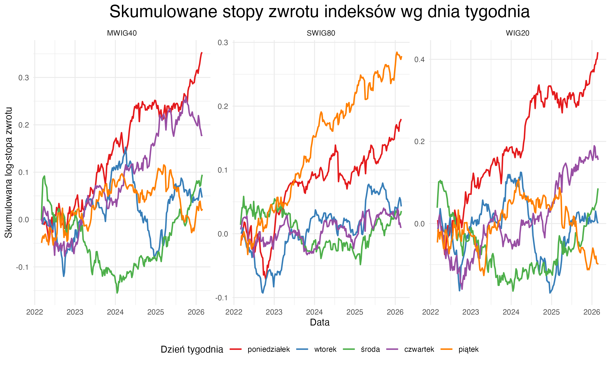
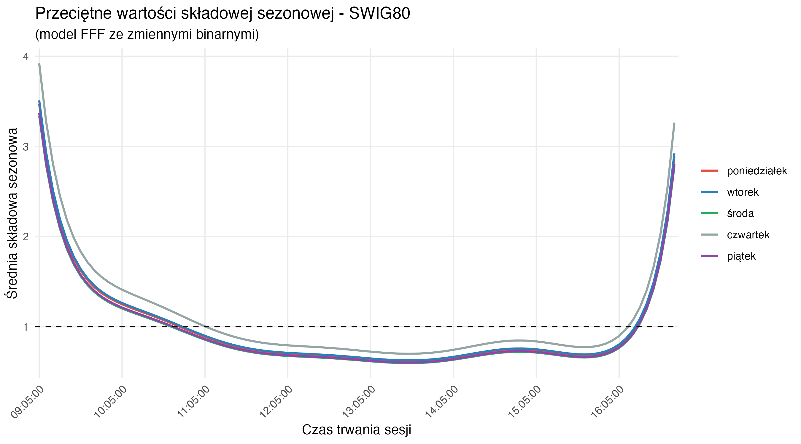

# Day-of-the-Week Effect and Intraday Seasonality on the Warsaw Stock Exchange (GPW)

An empirical econometric investigation of calendar anomalies, return distributions, conditional volatility persistence, trading volume seasonality, and intraday market microstructure across the three primary equity indices of the Warsaw Stock Exchange: **WIG20** (large-cap blue chips), **mWIG40** (mid-cap), and **sWIG80** (small-cap).

> **Academic Context:** Bachelor's Thesis defended at **AGH University of Krakow** (Faculty of Management, Department of Applications of Mathematics in Economics, 2026), supervised by dr Milena Suliga.

---

## 1. Datasets & Scope

* **Daily Market Data (`2022-03-01` to `2026-02-27`):** Daily OHLC prices and aggregated index trading volumes sourced from Stooq.pl, adjusted for non-trading holidays via continuous close-to-close log returns.
* **High-Frequency Intraday Data (`2025-01-03` to `2025-06-26`):** Tick-by-tick index quotations aggregated into **5-minute logarithmic returns** during continuous trading hours (excluding overnight gaps to isolate pure intraday dynamics).

---

## 2. Econometric Methodology

1. **Distributional & Time-Series Diagnostics (`R/01_descriptive_statistics.R`):**
   * Stationarity verification via **Augmented Dickey-Fuller (ADF)** tests.
   * Normality and tail-thickness evaluation via **Jarque-Bera (JB)** tests, skewness, and kurtosis.
   * Serial correlation checks using **Ljung-Box Q-tests**.
2. **Daily Return Calendar Regressions (`R/02_dummy_regression_models.R`):**
   * No-intercept OLS regressions on weekday dummy variables ($D_{\text{Mon}}, \dots, D_{\text{Fri}}$) to avoid the dummy variable trap.
   * Residual diagnostics using **Breusch-Pagan** (heteroskedasticity) and **Breusch-Godfrey** (autocorrelation) LM tests, followed by joint **Wald linear restriction tests** ($H_0: \alpha_1 = \alpha_2 = \alpha_3 = \alpha_4 = \alpha_5$).
3. **Trading Volume & Derivatives Expiration Decomposition (`R/05_volume_data_preparation.R`, `R/06_volume_seasonality_models.R`):**
   * OLS regressions of percentage volume deviations from sample means on weekday dummies plus an explicit indicator for **Triple Witching Days** (*Dni Trzech Wiedźm* — quarterly expiration of index futures and options on the third Friday of March, June, September, and December).
   * Estimated with **Newey-West HAC** robust standard errors to correct for strong volume autocorrelation ($p < 0.0001$).
4. **Conditional Volatility Modelling (`R/03_garch_volatility_models.R`):**
   * **ARCH-LM** tests confirming volatility clustering across all indices ($p < 0.0001$).
   * **sGARCH(1,1)** models estimated under **Student's t-distribution** innovations with exogenous day-of-the-week dummy variables in the conditional variance equation.
5. **Intraday Seasonality Filtering (`R/04_intraday_seasonality_fff.R`, `R/07_volatility_visualization.R`):**
   * Multiplicative intraday volatility decomposition using the **Flexible Fourier Form (FFF)** filter (Andersen & Bollerslev, 1997; Gurgul & Suder, 2013) combining a quadratic time-of-day trend, trigonometric harmonics ($P \in \{1, 2, 3, 4\}$ selected via **AIC**), and weekday shift dummies.

---

## 3. Key Empirical Findings

### A. Fat Tails & Non-Normality Across Market Cap Segments
All return series are stationary (ADF $p = 0.01$) and strongly reject normality (Jarque-Bera $p < 0.001$). Tail thickness and negative skewness increase inversely with company size, peaking in **sWIG80** (kurtosis = `6.347`), whereas broad diversification across 80 constituents lowers its overall daily return standard deviation (`0.007`) relative to **WIG20** (`0.014`).

| Index | Mean Daily Log-Return | Std. Dev. | Skewness | Kurtosis | Jarque-Bera ($p$-val) | Ljung-Box ($p$-val) |
| :--- | :---: | :---: | :---: | :---: | :---: | :---: |
| **WIG20** | 0.00056 | 0.014 | -0.001 | 3.807 | < 0.001 | 0.465 |
| **mWIG40** | 0.00069 | 0.011 | -0.096 | 4.593 | < 0.001 | 0.447 |
| **sWIG80** | 0.00055 | 0.007 | -0.513 | 6.347 | < 0.001 | 0.059 |

### B. Point Calendar Effects vs. Joint Market Efficiency
Individual $t$-tests identify statistically significant positive Monday returns for **WIG20** ($\beta = 0.00212$, $p = 0.0365$) and **mWIG40** ($\beta = 0.00179$, $p = 0.0245$), alongside a positive Friday effect for **sWIG80** ($\beta = 0.00140$, $p = 0.0068$). However, **joint Wald tests fail to reject equality of mean returns across the week** for all three indices ($p = 0.4265$, $0.5691$, and $0.2786$), indicating that point asymmetries are not strong enough to systematically violate weak-form market efficiency.

### C. Debunking the "Friday Volume Effect" via Triple Witching Days
Once quarterly derivatives expiration dates are isolated, regular Fridays show **no statistically significant excess trading volume** across any index ($p > 0.45$). Instead, turnover surges are driven mechanically by derivatives rollovers and arbitrage:
* **WIG20:** Volume jumps by **+148.9%** on Triple Witching Days ($p < 0.0001$), while regular Mondays exhibit a genuine liquidity drop of **-13.0%** ($p = 0.0003$; joint Wald $p < 0.0001$).
* **mWIG40:** Volume increases by **+78.2%** on Triple Witching Days ($p < 0.0001$), with no significant weekday asymmetry otherwise (Wald $p = 0.2537$).
* **sWIG80:** Unaffected by Triple Witching Days ($-1.3\%$, $p = 0.9181$) due to the absence of liquid index derivatives.

### D. Conditional Volatility Persistence (`sGARCH(1,1)` with Student's $t$)
Weekday dummy variables in the variance equation are statistically insignificant across all indices ($p \in [0.44, 1.00]$), confirming that conditional risk does not follow a day-of-the-week pattern. However, shock propagation differs substantially across segments:

| Index | ARCH ($\alpha$) | GARCH ($\beta$) | Persistence ($\alpha + \beta$) | Student-$t$ DoF ($\nu$) | Weekday Dummies ($p$-val) |
| :--- | :---: | :---: | :---: | :---: | :---: |
| **WIG20** | 0.0490 ($p < 0.001$) | 0.9197 ($p < 0.001$) | 0.9686 | 18.67 | 0.812 – 1.000 |
| **mWIG40** | 0.0178 ($p = 0.474$) | 0.9707 ($p < 0.001$) | 0.9885 | 7.41 | 0.983 – 0.995 |
| **sWIG80** | 0.1897 ($p < 0.001$) | 0.5670 ($p < 0.001$) | 0.7567 | 4.89 | 0.442 – 1.000 |

### E. Intraday Microstructure & FFF Filtering
AIC minimization selects **$P = 2$** harmonics for **WIG20** and **$P = 3$** for **mWIG40** and **sWIG80**, capturing a pronounced **U-shaped intraday volatility profile** ($\delta_1 < 0, \delta_2 > 0$, $p < 0.001$). After removing overnight returns and filtering intraday seasonality, continuous trading sessions exhibit strong weekday symmetry in WIG20 and mWIG40 ($p > 0.14$), with only a minor Thursday shift in sWIG80 ($\gamma_4 = 0.1515$, $p = 0.034$). This suggests that daily calendar effects originate primarily from overnight information accumulation and opening auction dynamics rather than persistent intraday distortions.

---

## 4. Repository Structure

    gpw-day-of-the-week-effect/
    ├── README.md
    ├── R/
    │   ├── 01_descriptive_statistics.R    # Stationarity (ADF), Jarque-Bera, Ljung-Box diagnostics
    │   ├── 02_dummy_regression_models.R   # Daily return OLS models, BP/BG tests & Wald restrictions
    │   ├── 03_garch_volatility_models.R   # ARCH-LM tests & sGARCH(1,1)-t with weekday dummies
    │   ├── 04_intraday_seasonality_fff.R  # 5-min Flexible Fourier Form (FFF) estimation & AIC selection
    │   ├── 05_volume_data_preparation.R   # Index volume normalization & Triple Witching tagging
    │   ├── 06_volume_seasonality_models.R # Volume regressions with Newey-West HAC standard errors
    │   └── 07_volatility_visualization.R  # ggplot2 intraday U-shape & filtered return profiles
    ├── figures/
    │   ├── 01_returns.png
    │   └── 02_FFF.png
    └── thesis/
        └── Badanie_Efektu_Dnia_Tygodnia_GPW_PL.pdf

---

## 5. Future Extensions

* **Asymmetric Volatility Specifications:** Extending daily and intraday models to **EGARCH** and **TGARCH** frameworks to test leverage effects and asymmetric market reactions to weekend news shocks.
* **Intraday Liquidity & Spreads:** Investigating calendar seasonality in bid-ask spreads to quantify hidden transaction costs around the Monday open.
